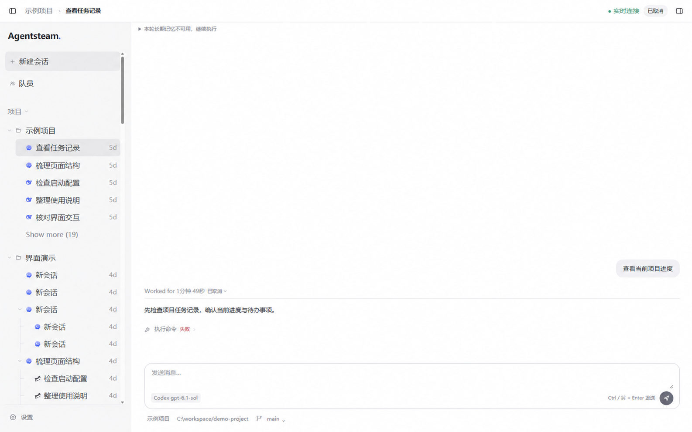
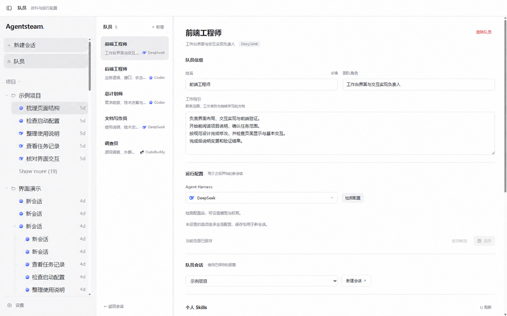
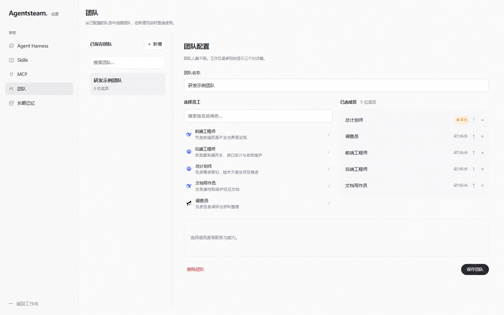
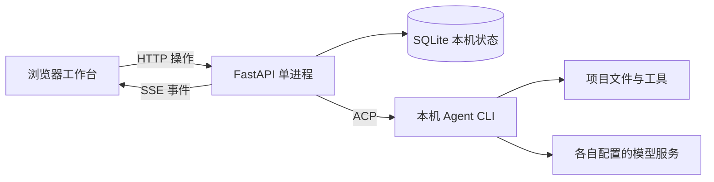

<h1 align="center">Agentsteam</h1>

<p align="center">
  <strong>把本机编程 Agent 组织成一支可复用的协作团队。</strong><br>
  项目与会话 · 队员身份与 Skills · 队长委派 · 并排协作 · 可选长期记忆
</p>

[功能与展示](#功能与展示) · [快速启动](#快速启动) · [Agent 配置](#agent-配置) · [团队协作示例](#团队协作示例) · [常见问题](#常见问题) · [文档导航](#文档导航)

Agentsteam 是一个在浏览器中使用的本地多智能体协作工作台。接入已经安装并完成认证的 Codex、OpenCode、CodeBuddy 或 DeepSeek，为队员设定职责、运行配置和个人技能，在同一项目中分配工作、查看执行过程与文件变化。

你可以从一个普通会话开始，也可以组建包含队长和成员的团队。队员资料与团队模板可以重复使用；会话历史和协作状态保存到本机，Agent 通过各自配置的模型服务执行任务。

当前提供源码启动方式，主要面向 Windows 本机使用。基础工作台只需 Python 环境与 Agent CLI；长期记忆按需配置。

## 功能与展示

| 能力 | 你可以做什么 |
| --- | --- |
| 项目与会话 | 绑定本机工作目录，管理历史，查看流式消息、工具调用与执行状态，取消运行 |
| 智能体接入 | 在同一工作台使用 Codex、OpenCode、CodeBuddy、DeepSeek，各自沿用本机安装与认证 |
| 队员身份 | 为队员配置名称、职责、工作指引、Harness 与个人 Skills，创建会话时冻结身份快照 |
| 团队协作 | 保存团队模板、指定唯一队长，由队长委派任务、查询进展、读取结果或取消执行 |
| 并排会话 | 最多三个会话并排查看，按任务选择继续已有成员上下文或单开会话 |
| 文件与 Git | 查看回复中的文件变更、只读预览和项目 Git 信息，检查绑定独立 worktree 的任务 Diff |
| 配置与权限 | 检测 Harness 能力、设置运行配置，浏览全局 Skills/MCP；权限行为受当前配置与原生 Agent 约束 |
| 可选长期记忆 | 使用共享池或队员独立记忆库，通过 Retain、Recall、Reflect 保存、检索和归纳经验 |

以下展示图基于实际界面截图，经 AI 脱敏处理；项目名称、路径、团队名称与会话内容均为通用示例。

### 工作台：把项目、会话与执行过程放在一起

从左侧项目列表切换会话，在消息区查看回复与工具活动，结合运行状态判断任务进展。文件变更与只读预览帮助你检查执行结果。



### 队员管理：让职责和个人技能保持稳定

分别配置队员的职责、工作指引和运行环境，例如让前端工程师负责页面交互、后端工程师负责接口、文档写作员负责使用说明。每个新会话冻结当时的身份与技能快照，便于保留执行依据。



### 团队设置：保存成员组合，按任务组织协作

从已有队员中选择成员并指定队长，新建项目时应用团队模板。队长通过 MCP 委派任务，成员独立执行；你可以打开成员会话查看过程或直接交流。



详细规则见 [队员说明](EMPLOYEES.md) 与 [团队说明](TEAM_WORKSPACE.md)。

## 环境要求

| 组件 | 要求 |
| --- | --- |
| 操作系统 | 当前发布配置与启动脚本面向 **Windows** |
| Python | **3.12+**，依赖由 `uv.lock` 锁定 |
| Python 环境管理 | [uv](https://docs.astral.sh/uv/) |
| Git | 项目 Git 信息、worktree 与任务 Diff 需要本机 Git |
| Node.js | 队员原生适配和前端测试需要；现有验收使用 **24.11.0** |
| Agent CLI | 至少准备下方支持列表中的一种，并在本机完成登录或模型配置 |

前端采用原生 HTML、CSS 和 JavaScript，无需单独构建。其他系统可尝试后面的手动启动命令，但当前队员适配中的 OpenCode 入口限定为 Windows 可执行文件。

## 快速启动

### 1. 准备源码与本机配置

克隆仓库或下载源码后，进入包含 `pyproject.toml` 的仓库根目录。在 PowerShell 中执行：

```powershell
Copy-Item agents.example.toml agents.toml
```

编辑 `agents.toml`，将示例程序路径替换为本机实际路径，并将未安装的 Agent 设置为 `enabled = false`。支持的版本和入口见 [Agent 配置](#agent-配置)。

### 2. 安装锁定依赖并启动

```powershell
uv sync --locked
.\start.cmd
```

打开 <http://127.0.0.1:8765/>。接口文档位于 <http://127.0.0.1:8765/docs>。在启动窗口按 `Ctrl+C` 停止服务。

打开工作台和浏览已有数据不需要调用模型。配置检测可能启动 Agent 进程；发送任务会使用该 CLI 的模型配置。

### 3. 开始第一个会话

1. 新建项目，选择本机已有的工作目录。
2. 创建普通会话并选择已配置的 Agent。
3. 先发送一个范围明确的任务，例如“阅读项目说明，概述目录结构与启动方式，先不要修改文件”。
4. 查看回复、工具活动和运行状态；需要多人协作时，再创建队员与团队。

首次启动会创建本地 SQLite 数据库。使用 `start.cmd` 启动和停止应用，不会替你安装或登录 Agent CLI。

<details>
<summary>手动启动命令</summary>

在仓库根目录执行：

```powershell
uv run --locked uvicorn app.main:app --host 127.0.0.1 --port 8765 --workers 1 --timeout-graceful-shutdown 5
```

</details>

## Agent 配置

`agents.example.toml` 是配置模板，`agents.toml` 是本机实际配置。模板中的 `C:/agent-tools/` 是示例位置，必须改成实际安装路径；TOML 不会展开 `%APPDATA%`、`$env:...` 或 `~`。

这里的 Harness 指负责运行 Agent 的本机 CLI/适配程序。队员原生适配会核对以下包版本和入口，版本不匹配时明确拒绝启动：

| Harness | 队员适配要求的包版本 | 入口 |
| --- | --- | --- |
| Codex | `@agentclientprotocol/codex-acp@2.0.1` | `dist/index.js`，由 Node 启动 |
| OpenCode | `opencode-ai@1.19.0` | `bin/opencode.exe` |
| CodeBuddy | `@tencent-ai/codebuddy-code@2.167.0` | `bin/codebuddy --acp`，由 Node 启动 |
| DeepSeek | `deepseek-acp@0.9.0` | `lib/bin.js`，由 Node 启动 |

这些 CLI 不由 Python 依赖安装。先按各自工具的方式完成安装与认证，再填写路径。在“设置 → Agent Harness”检测运行能力、选择可用的模型或配置；实际选项取决于所选 Agent 返回的能力。

认证和模型服务由各 CLI 自己管理，工作台中的设置覆盖不修改 CLI 全局配置。修改启动配置后需重启后端；已建立的会话仍受原生连接生命周期约束。全局 Skills/MCP 页面提供只读发现与预览，发现配置不等于运行会话已经加载或连接。

> [!WARNING]
> 模板保留现有的完整执行权限：Codex、OpenCode、CodeBuddy 默认放宽原生权限确认；未显式限制时，应用也会自动选择允许的权限选项。Agent 可以按宿主账号权限读写文件和执行命令。请先检查配置，并只打开可信项目。应用面向本机使用，保持监听 `127.0.0.1`；不提供面向互联网的完整用户认证。

## 团队协作示例

以“梳理一个已有项目并补充使用说明”为例，可以自行创建以下队员。仓库提供应用能力与技能维护指引，示例队员资料由使用者创建。

| 队员 | 工作指引示例 |
| --- | --- |
| 总计划师，担任队长 | 明确任务范围，拆分独立工作，给出验收要求，核对证据后汇总 |
| 后端工程师 | 阅读接口与启动逻辑，说明依赖、配置条件和实际限制 |
| 文档写作员 | 根据已经核实的结论整理使用说明，检查命令与本地链接 |

1. 在“队员”中保存各自资料，选择 Harness 并检测运行配置。
2. 在“设置 → 团队”中选择这三位队员，指定总计划师为唯一队长。
3. 新建项目，选择已有工作目录与团队模板，进入队长会话。
4. 给队长明确目标和验收标准，再打开成员会话并排查看过程。

可以向队长这样描述任务：

```text
先阅读项目说明，确认现有启动方式。将接口与依赖核对交给后端工程师，
将使用说明整理交给文档写作员。每项结论附文件依据，文档命令必须核对。
先汇总发现与修改范围，再进行需要的文档修改；完成后说明实际验证结果。
```

委派由队长 Agent 调用协作工具完成。成员收到任务目标和验收要求，不自动继承队长完整聊天记录；需要共享的背景应写进任务。上下文可选择“继续”或“单开”，团队成员不继续向下委派。

> [!NOTE]
> 最多三个会话窗口并排，关闭窗口不取消后台任务。多个 Agent 写同一目录时需要协调文件范围；要隔离修改，先准备独立 worktree，再在委派中指定已有目录。应用不会自动为委派创建 worktree。任务进入待验收状态后仍需核对结果。

## 可选长期记忆

基础工作台不需要 PostgreSQL 或记忆模型。使用长期记忆时，先安装额外依赖：

```powershell
uv sync --locked --extra memory
.\start.cmd memory
```

还需准备带 pgvector 的专用 PostgreSQL 数据库，以及生成、Embedding、Rerank 三类模型连接，在“设置 → 长期记忆”中填写后启用。共享池和队员个人记忆默认关闭。

| 能力 | 用途 |
| --- | --- |
| Retain | 保存值得复用的事实、约定与经验，并保留来源 |
| Recall | 在后续任务中检索相关记忆，作为当前工作的参考 |
| Reflect | 按需综合已有记忆回答问题，结果默认不再次保存 |

普通会话使用共享池，队员使用个人独立记忆库；关闭个人记忆不会回退到共享池。旧聊天不会自动回填，模型生成的内容也不自动成为已核实事实。

数据库安装、管理和模型要求见 [长期记忆配置](MEMORY.md)。`start.cmd memory` 只会启动已经配置好的项目内数据库，不会自动安装数据库或填写模型凭据。

## 工作原理与目录

FastAPI 后端负责会话、任务和配置；浏览器操作走 HTTP，运行事件通过 SSE 推送。编程 Agent 由后端作为外部工具进程管理。



可选长期记忆在同一应用进程内使用 Hindsight 引擎，另需 PostgreSQL + pgvector 与相应模型服务。

```text
app/
  agents/        ACP 接入、Harness 与队员原生适配
  api/           HTTP 接口与 SSE
  db/            SQLite 存储
  services/      会话编排、队员、团队与配置
  mcp/           会话协作与记忆工具桥
  delivery/      Git Diff 与文件预览边界
  memory/        可选长期记忆
  skills/        应用内技能维护指引及引用
  static/        原生 HTML、CSS、JavaScript 与静态资源
docs/images/     脱敏界面展示图
scripts/         ACP 验收、PostgreSQL 与 pgvector 辅助脚本
tests/           Python 与 Node 自动测试、手动验收脚本
```

`data/` 保存本机历史、队员资料和可能含密钥的配置；`.runtime/` 保存本机组件与凭据。这些目录、实际 `agents.toml`、虚拟环境和日志均被忽略，不随源码上传。

## 常见问题

<details>
<summary>页面能打开，但 Agent 无法启动，先检查什么？</summary>

确认 `agents.toml` 指向实际可执行文件，相关 Agent 已在本机完成认证。队员会话还需满足上方的包版本与入口要求。修改启动配置后重启后端，读取启动窗口中的具体错误，再重新检测配置。

</details>

<details>
<summary>修改队员资料或技能后，为什么旧会话没有变化？</summary>

会话创建时会冻结身份和技能快照。修改维护源后，新会话使用新版本，已有会话保留原快照。个人记忆开关则按当前设置生效。

</details>

<details>
<summary>服务重启后，可以直接继续原来正在运行的会话吗？</summary>

会话与任务历史保留，原生运行连接和内存队列不自动恢复。连接丢失后需要新建会话继续；长期记忆不能替代原生连接恢复。

</details>

<details>
<summary>数据存在哪里？调用模型会产生费用吗？</summary>

应用状态保存在本机 SQLite，队员资料与运行快照保存在本机 `data/`。Agent 执行任务时会按各 CLI 的配置访问模型和外部工具；启用长期记忆后也会访问所配置服务。相关内容传输与费用取决于这些服务，使用前需检查其配置。数据库可能包含凭据，应按敏感文件管理。

</details>

## 测试与运行边界

复制配置模板后，可运行已有的自动测试：

```powershell
# 完整 Python 回归中的上游分块器测试需要 memory 额外依赖。
uv sync --locked --extra memory
$env:NO_PROXY = '127.0.0.1,localhost'
uv run --locked --extra memory python -m pytest -q
node --test tests/test_*.cjs
```

自动回归使用临时 SQLite、Git 仓库和 ACP/模型替身。`tests/verify_*` 等手动验收另外依赖本机 CLI 或指定版本 Chromium，部分需要单独配置，运行前应阅读脚本。

发布副本整理时，Python **555 项**、Node **164 项**自动测试通过，并验证了未安装长期记忆额外依赖时的基础启动、静态页面和接口文档。上述结果不代表所有真实 CLI、云端模型与数据库组合均已完成端到端验收。

`scripts/acp_smoke.py` 同时供生命周期测试复用，也支持真实 CLI 手动验收；手动运行必须显式传入 `--cwd` 指定独立测试仓库。部分场景会调用模型或创建探测文件，原始记录写入被忽略的 `.runtime/`，不应公开上传。

- 后端使用单进程、单 Uvicorn worker；同一会话 FIFO，不同会话可以独立运行。
- 服务重启后历史保留，原生运行连接与内存队列不自动恢复；连接丢失时需新建会话。
- 任务进入待验收状态不代表已经交付。共享工作目录的修改不能逐个归属给不同 Agent；任务级 Diff 需要独立 worktree。

## 文档导航

| 你想了解 | 阅读 |
| --- | --- |
| 队员身份、个人技能与会话快照 | [队员说明](EMPLOYEES.md) |
| 团队模板、委派与并排会话 | [团队说明](TEAM_WORKSPACE.md) |
| 长期记忆的数据库、模型与启停 | [长期记忆配置](MEMORY.md) |
| 记忆模块的实现与数据流 | [记忆后端说明](app/memory/README.md) |
| 随源码分发资源的许可与来源 | [第三方组件说明](THIRD_PARTY_NOTICES.md) |
